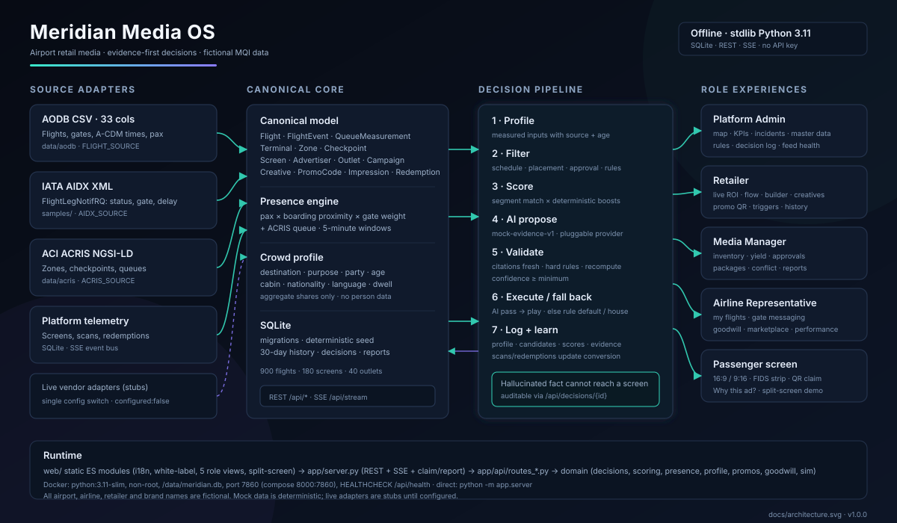

# Meridian Media OS

Airport retail media OS for the fictional **Meridian International Airport (MQI)**. It turns AODB flight movements, IATA AIDX updates, ACI ACRIS zone/queue data and live screen/scan/redemption telemetry into evidence-first ad decisions on airport screens.

The POC is **offline-first, dependency-free and demo-ready**: a Python 3.11 standard-library backend, vanilla ES-module frontend, SQLite storage, REST API and SSE live updates. No API key, cloud service or paid dependency is required.

> All airport, airline, retailer, brand, flight and passenger data is **fictional and synthetic**. Names, codes and campaigns are invented for the challenge. No real airport, airline or brand marks are used. Targeting is aggregated by flight, zone and time window only; there is no per-passenger, boarding-pass or device tracking.

## Playground

**Live demo:** <https://meridian-media-os.onrender.com>

The deployed Render web service runs the full Python backend: health, SSE, decisions, claim QR and all five role views. It is seeded on boot (900 flights, 180 screens, 25 campaigns) and uses an ephemeral SQLite file, so a redeploy resets the demo to the same deterministic initial state. Render's free instance spins down after inactivity; the first request after idle can take 30–60 seconds to wake, then the app is live.

The identical image runs locally with `docker compose up --build` (see below). No paid hosting or API key is required.

## One-command start

### Docker (recommended, matches the hosted playground)

```bash
docker compose up --build
```

Open **http://localhost:8000**. Compose maps host `8000` to container `7860`, seeds the database on first boot and persists it in the `meridian-data` volume.

### Direct Python (no dependencies)

```bash
python -m app.server
```

Open **http://localhost:7860**. Set `PORT=8000` to match compose. On first boot the app creates the SQLite schema, generates the seed (900 flights, 180 screens, 40 outlets, 22 advertisers/10 airlines, 25 campaigns, 30 days of history) and writes adapter-shaped fixtures under `data/`.

To rebuild the seed explicitly:

```bash
python -m app.seed --reset
```

Python **3.11+** is the only prerequisite. There are no `pip install` steps; the backend uses only the standard library.

## Architecture



- **Frontend** — `web/`: role switcher, dark control-room Admin view, light business views, 9:16/16:9 passenger screen, mobile claim page, shared design system, i18n (English + configurable second language) and simulated clock.
- **Backend** — `app/server.py`: static UI, JSON REST API, SSE stream, public claim page and shareable advertiser report.
- **API** — `app/api/routes_*.py`: one module per role, composed by `app/api/router.py`. OpenAPI: [`docs/openapi.yaml`](docs/openapi.yaml) and live at `/openapi.yaml`.
- **Domain** — `app/domain/`: crowd profile, presence, scoring, evidence-first decisions, promos, goodwill and the simulation/event bus.
- **Adapters** — `app/adapters/`: isolated source translation; the core only sees the canonical model.
- **Storage** — SQLite with SQL migrations in `app/migrations/` and deterministic seeding in `app/seed*.py`.

## Data adapters

| Source | Standard / shape | Mock adapter | Canonical entities | Live switch |
|---|---|---|---|---|
| AODB movements | CSV, one row per flight leg, **33 columns** as in the reference sample (A-CDM TOBT/TSAT/AIBT/AOBT, gate, stand, counters, belt, aircraft, pax, status, IATA delay codes, codeshares) | `AodbCsvSource` reads `data/aodb/flights_<date>.csv`; sample fixture `samples/aodb_reference_2026-10-14.csv` (320 legs) | `Flight`, `GateAssignment`, `AircraftType` | `FLIGHT_SOURCE=vendor-api` → `VendorFlightSource` stub |
| IATA AIDX | `IATA_AIDX_FlightLegNotifRQ` XML pushed on a simulated feed | `AidxXmlSource` parses status/gate/delay/pax updates; sample `samples/aidx_reference_arrival.xml` | `FlightEvent` | `AIDX_SOURCE=live-aidx` → `LiveAidxSource` stub |
| ACI ACRIS | NGSI-LD style JSON entities (terminal, concourse, checkpoint, queue, measurement) | `AcrisJsonSource` reads `data/acris/entities.json` | `Terminal`, `Zone`, `Checkpoint`, `QueueMeasurement` | `ACRIS_SOURCE=live-acris` → `LiveAcrisSource` stub |
| Platform-owned | SQLite tables | seeded master data and live metrics | `Screen`, `Advertiser`, `Outlet`, `Campaign`, `Creative`, `PromoCode`, `Impression`, `Redemption` | n/a |

The adapter contract is `FlightSource.snapshot()/stream()` and `QueueSource.measurements()`; switching a source is a **single environment value**, not a code change. Live stubs raise `AdapterNotConfigured` and are surfaced as `configured: false` by `/api/health` and `/api/meta`, so the demo cannot silently pretend a live feed exists. Full contract, add-a-source guide and field mappings: [`docs/ADAPTERS.md`](docs/ADAPTERS.md).

## Evidence-first decision pipeline

Every screen/slot runs the same pipeline about every 15 simulation seconds:

1. **Profile** — build the crowd profile for the screen catchment (next 5-minute window) from nearby flights weighted by gate proximity and time to boarding, plus the latest ACRIS queue measurement. Attributes are aggregate shares only.
2. **Filter** — drop campaigns failing hard rules: schedule/daypart, placement, approval status, brand safety, domestic/international, destination, minimum dwell, minimum crowd, airline/competitor constraints, budget.
3. **Score** — segment-weighted audience match × deterministic boosts, with a logged, reproducible formula.
4. **AI propose** — the pluggable provider (default `mock-evidence-v1`) ranks candidates and cites recorded inputs.
5. **Validate** — every citation must exist in a trusted feed and be fresh; hard rules must still pass; the score must be recomputed bit-for-bit; confidence must clear the minimum.
6. **Execute or fall back** — if any check fails, the AI choice is rejected and the highest-scoring rule-eligible campaign plays (or the house flight-information campaign). A hallucinated fact cannot reach a screen.
7. **Log and learn** — the decision stores the profile, all candidates/scores, winner reason, validation checks and full evidence trail. Scans/redemptions update segment conversion estimates.

Audit any decision from the Admin decision log or `GET /api/decisions/{id}`. The passenger “Why this ad?” overlay shows the same crowd bars, top-3 candidates and winning rule.

## Roles and implemented features

### Platform Admin — operator console
- Live terminal map (T1/T2, stylised) with screen dots coloured online/degraded/offline and passenger-presence heat.
- KPI strip: screens online %, plays today, impressions, revenue today (configurable currency), active campaigns, decisions, fallbacks, average latency.
- Auto-raised incident/bug tracker (screen offline, feed lag, failed creative) with severity, owner and status; create/update incidents.
- Master data list + create/edit for vendors/retailers, outlets/F&B, airlines, locations (terminal/zone/gate) and screens.
- Editable global rules (segment weights, exploration, frequency cap, competitor separation, minimum confidence).
- Searchable decision log with per-decision evidence audit.
- Feed health (AODB/AIDX/ACRIS adapter, mode, configured, last message) and performance panel (API p95, playlist build, uptime).

### Retailer — shop or F&B outlet
- Live dashboard: impressions, scans, redemptions, conversion, attributed revenue, active campaigns and live promos.
- Passenger flow near the store for the next 2 hours with top destinations and nationalities.
- Campaign builder: creative, zones/screens/gates, segment weights, hard filters, schedule/daypart, budget, caps; live screen preview and match estimate.
- Creative library: reuse/duplicate, upload or generate an on-brand page; pending brand-safety approval.
- Time-boxed promo codes and QR that expire with the linked flight's boarding; share-to-family creates a second code.
- Campaign history with spend, impressions, redemptions, ROI and one-click re-run.
- Trigger rules (delay/gate change/boarding/festival), stock-aware pause toggle, budget pacing and A/B groups; segment recommendations.

### Media Manager — ad sales and inventory
- Inventory calendar: screens × hours, booked/available/premium (high predicted footfall).
- Yield and pricing driven by predicted passenger presence, occupancy and 7-day revenue forecast.
- Approval queue for creatives/campaigns with brand-safety checklist and approve/reject.
- Advertiser overview: spend ranking, running campaigns, under-delivery flags.
- Package builder, conflict view explaining why A beat B, and one-click shareable advertiser report.

### Airline Representative
- My flights today: gate, status, delay, load factor and timeline for the selected fictional airline.
- Gate-area messaging: schedule sponsored content on own gates for the boarding window.
- Delay goodwill automation: threshold-based meal/lounge voucher co-funded with an F&B retailer, pushed to gate screens.
- Co-marketing marketplace: retailers offer deals, airline accepts in one click.
- Performance among the airline's own passengers (impressions/redemptions).

### Passenger screen simulator
- Full-screen 9:16 or 16:9 rendering of a chosen physical screen by gate/zone.
- FIDS-style context strip of nearby flights next to the ad.
- Playlist visibly changes as simulation time moves and flights board, delay or depart.
- Promo QR with live countdown; scanning on a phone on the same LAN opens the mobile claim page and records a redemption visible immediately in the Retailer dashboard.
- “Why this ad?” overlay with crowd profile, top-3 scores and winning rule.

## 60-second demo script

Start at **http://localhost:8000** with the simulation running at 1× (jump to ~14:10 if needed).

1. **Gate 42 / DXB delay (0–15 s).** Open **Passenger Screen**, choose **T2-F → Gates 40–48 → Gate 42** (`SCR-122`). The context strip shows **ZO501 to DXB, 240 pax, delayed 45 min** next to **YU88 to SCJ**. In the simulation bar use **Inject → delay** for `ZO501` at Gate 42 (or 45 min).
2. **Cause and effect (15–30 s).** Switch to **Airline → Solano Airways**: ZO501 is delayed; gate-area messaging and the goodwill automation react. Switch to **Retailer → Meridian Duty Free (ADV-01)**: the delay trigger re-scores the DXB/Gulf offers and the zone crowd rises.
3. **Passenger claim (30–45 s).** Back on the passenger screen, the live promo QR (e.g. `MQI-SKY35` / `MQI-GOLD15`) has a countdown. Scan it with a phone on the same LAN; the mobile claim page opens and the claim is recorded.
4. **Money appears (45–60 s).** The Retailer dashboard ticks up scans/redemptions/revenue immediately (SSE), and the campaign history/ROI updates. Open **“Why this ad?”** to show the crowd profile, top-3 candidates and the winning evidence-backed rule.

Optional WOW: **Retailer → Creative library → GenAI assistant**, brief `Festive sweets, 20% off, families flying domestic`, and get a ready ad page in English + the configured second language. Use the **split-screen** mode (passenger left, role dashboard right) throughout.

The delay/claim/redemption loop is designed to update within ~2 seconds of the injected feed event.

## GenAI creative assistant (mocked, pluggable)

`AI_PROVIDER=mock` (default) returns deterministic, template-based ad copy and layouts in English and the configured second language, so the demo works with no key. The provider interface also exposes ranking; a real LLM/provider can be plugged in without touching the decision pipeline or UI. AI output is always subject to the deterministic validation described above.

## i18n and white-label

- UI and ad content are English plus `SECOND_LANGUAGE` (default `zh`).
- `PRODUCT_NAME`, `PRODUCT_SHORT`, `AIRPORT_CODE`, `AIRPORT_NAME`, `CURRENCY`, `LOCALE` theme the product. All marks are fictional and configurable; no real airport/airline/brand assets.
- Dark control-room theme for Admin/Passenger, light business theme for Retailer/Media/Airline, mobile layout for the claim page.
- Responsive at 1440 px and 1920 px.

## Configuration

Every value is an environment variable; see `.env.example`.

| Variable | Default | Purpose |
|---|---|---|
| `HOST` / `PORT` | `0.0.0.0` / `7860` | Bind address and port |
| `DB_PATH` | `<root>/data/meridian.db` | SQLite file (compose uses `/data/meridian.db`) |
| `SEED_ON_BOOT` | `1` | Seed/migrate on startup |
| `SEED` | `1024` | Deterministic generator seed |
| `SIM_START` | `2026-10-24T13:55:00Z` | Simulation clock start |
| `SIM_SPEED` / `SIM_AUTOPLAY` | `1.0` / `1` | Initial speed and autoplay |
| `DECISION_INTERVAL` | `15` | Simulated seconds between decisions |
| `PRESENCE_WINDOW` | `30` | Presence rolling window (minutes) |
| `FEED_FRESH_SECONDS` / `AODB_FRESH_SECONDS` | `180` / `900` | Evidence freshness thresholds |
| `FLIGHT_SOURCE` | `mock-aodb` | `mock-aodb` or `vendor-api` |
| `AIDX_SOURCE` | `mock-aidx` | `mock-aidx` or `live-aidx` |
| `ACRIS_SOURCE` | `mock-acris` | `mock-acris` or `live-acris` |
| `AI_PROVIDER` / `AI_MODEL` | `mock` / `mock-evidence-v1` | Pluggable AI provider |
| `PUBLIC_BASE_URL` | empty | Public origin for QR claim links |
| `PRODUCT_NAME`, `PRODUCT_SHORT`, `AIRPORT_CODE`, `AIRPORT_NAME` | Meridian values | White-label identity |
| `CURRENCY` / `LOCALE` / `SECOND_LANGUAGE` | `EUR` / `en` / `zh` | Money and i18n |
| `MAX_HISTORY_DAYS` | `30` | Seeded history depth |
| `LOG_LEVEL` | `INFO` | Server logging |

## Tests and verification

No external test runner or dependencies are required. The acceptance suite uses
`unittest` and a temporary SQLite database:

```bash
python -m unittest tests.test_core -v         # 15 acceptance checks
python -m compileall app                      # syntax/import sanity
python tools/smoke_decision.py                # decision pipeline + evidence audit (dev DB)
python tools/inspect_db.py                    # seed sanity (dev DB)
```

The suite covers the AODB/AIDX/ACRIS adapters, profile plausibility, evidence
freshness and fallback, score reproducibility, promo create/share/claim/expiry,
QR structure, route matching and the full-scale seed counts. A developer-only
QR decode round-trip (`tools/check_qr.py`) additionally requires `zxing-cpp`
and Pillow; the shipped encoder itself is dependency-free and was verified
against that decoder during development.

API smoke checks against a running server:

```bash
curl http://127.0.0.1:8000/api/health
curl http://127.0.0.1:8000/api/admin/overview
curl "http://127.0.0.1:8000/api/retailer/dashboard?advertiserId=ADV-01"
curl http://127.0.0.1:8000/api/passenger/screens/SCR-122
curl http://127.0.0.1:8000/api/meta
```

Packaging checks:

```bash
docker compose config                         # validate compose
python -c "import xml.etree.ElementTree as E; E.parse('docs/architecture.svg'); print('svg ok')"
```

Security / hygiene scans (run before submission; do not commit secrets):

```bash
rg -n -i "(api[_-]?key|secret|password|private[_-]?key|bearer )" --glob '!data/**' --glob '!*.db*' .
rg -n "AKIA|ghp_|sk-[A-Za-z0-9]" --glob '!data/**' .
rg --files | rg "\.(db|db-wal|db-shm|pyc)$|__pycache__"
```

The app sets `X-Content-Type-Options`, `X-Frame-Options`, `Referrer-Policy`, `Permissions-Policy` and a restrictive CSP. It has no login by design (role switcher only), no payment integration and no per-passenger data.

## API

- OpenAPI 3.0.3: [`docs/openapi.yaml`](docs/openapi.yaml), also served at `/openapi.yaml`.
- Health: `GET /api/health` (liveness/readiness), `GET /healthz`.
- Config/theme: `GET /api/config`; seed/feed/AI metadata: `GET /api/meta`.
- Decision audit: `GET /api/decisions/{id}`; admin log: `GET /api/admin/decisions`.
- Live SSE: `GET /api/stream` (simulation, KPI, decision, incident, scan and redemption events).
- Public claim/report pages: `/claim/{code}` and `/report/{token}`.

## Documentation

- [`docs/ADAPTERS.md`](docs/ADAPTERS.md) — adapter contract, field mappings, freshness/evidence, add-a-source guide.
- [`docs/EVIDENCE.md`](docs/EVIDENCE.md) — requirement → code → test/demo matrix (Must/Should).
- [`docs/SECURITY.md`](docs/SECURITY.md) — final OpenGrep/Trivy results, justified false-positive exclusions and manual misconfig checklist.
- [`docs/architecture.svg`](docs/architecture.svg) — architecture diagram (standalone, no external assets).
- [`samples/REFERENCE_DATA.md`](samples/REFERENCE_DATA.md) — synthetic AODB/AIDX/ACRIS reference notes.

## Limitations

- Mock-first: AODB/AIDX/ACRIS live adapters are **stubs** by design; production feeds, credentials and vendor-specific schemas are out of scope.
- AI is a deterministic mock provider; it is pluggable but not a production LLM service.
- SQLite is single-node and single-writer; suitable for a laptop demo, not multi-tenant production.
- No authentication, payments, real CMS/screen hardware or production hosting.
- QR claim links require the phone and laptop on the same LAN (or `PUBLIC_BASE_URL`); some corporate Wi-Fi blocks client-to-client traffic.
- Latency/footfall/impressions are simulated from seed data; they are internally consistent but not measured from real sensors.
